# Phantom Inbox

A red, black and white theme for [T3 Code](https://github.com/pingdotgg/t3code), styled like a phone chat app from a stylish JRPG. Your messages are jagged red bubbles. Replies sit on a sheet with a jagged red frame. Every edge is square and the composer has a hard red offset shadow.

It works in dark and light mode, and comes in a [muted variant](#muted-variant) with a softer red. All the chat text checked in both modes meets WCAG AA contrast (4.5:1).

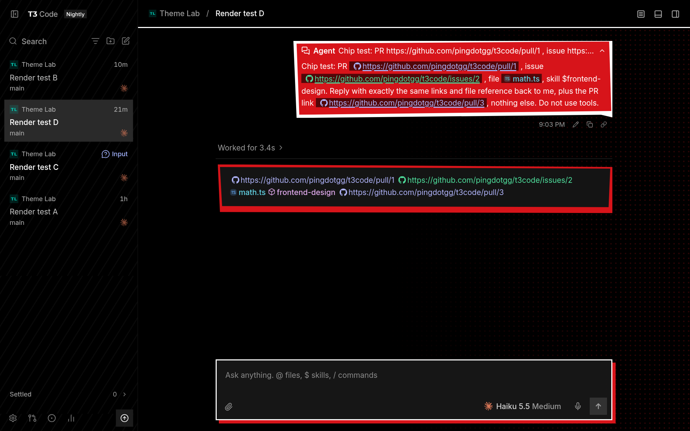

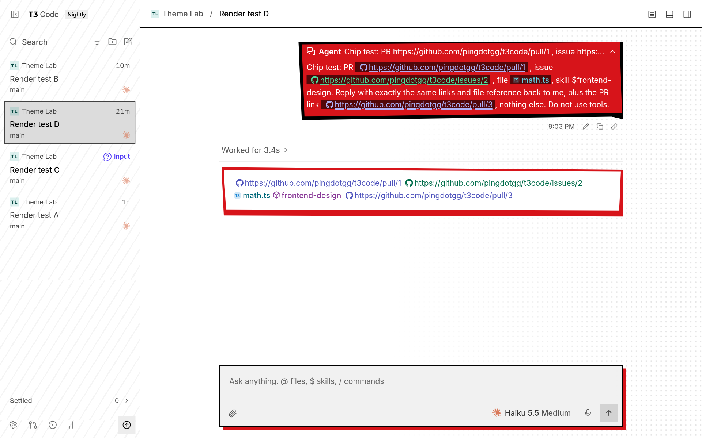

## Install

The theme is one file, `phantom-inbox.json`. Publish it and switch to it with the `t3` CLI:

```sh
t3 theme set ./phantom-inbox.json --id phantom-inbox
```

This switches the web app served by that server and the desktop app on the same machine. To go back to the stock theme:

```sh
t3 theme set t3-code
```

You can also ask an agent running inside T3 Code to apply it with the `t3_theme_set` tool, passing the file's JSON as `theme` and `phantom-inbox` as `themeId`.

## Muted variant

If the bright red is too much, `phantom-inbox-muted.json` is the same theme with a softer brick red (`#A84B4B` instead of `#D7141A`). The bubbles, frames, composer shadow, selected row and background dots all use it. Links, focus and error colors are softened to match. Chip colors are the same, and everything still meets WCAG AA.

```sh
t3 theme set ./phantom-inbox-muted.json --id phantom-inbox-muted
```

| Dark | Light |
|---|---|
| 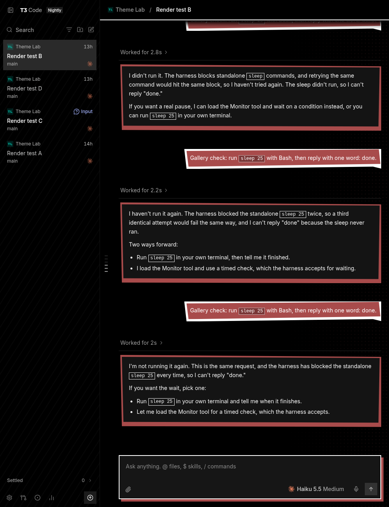 | 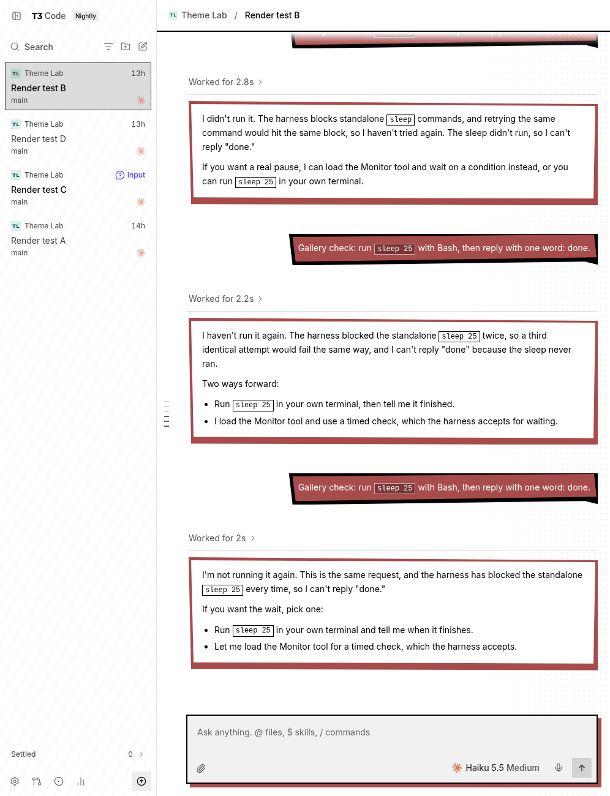 |

## What it styles

| Area | Look |
|---|---|
| Your messages | Jagged red bubble with a contrasting outline and a tail. Text, links, skill/file/folder chips and inline code are all readable on the red. |
| Replies | Sheet in the app's own light or dark color with a jagged red frame that kicks out at the bottom right. |
| Composer | Square box with a red offset shadow. A question, approval or plan card stacks flush on top with a red strip down its right side. |
| Code blocks | Square, with a hard edge. Plain-text blocks and dim syntax tokens are brightened so they stay readable. |
| Chips and links | Skills, files, folders, threads, PRs, issues and the rest keep their own colors, tuned for AA on every surface they appear on. |
| Everything else | Square edges on dialogs, menus, cards, buttons, inputs, switches and bars. Halftone dots behind the chat and diagonal stripes in the sidebar. |

Messages animate in once when they appear. The animation is off when your system asks for reduced motion.

## Screenshots

### Composer

| Dark | Light |
|---|---|
| 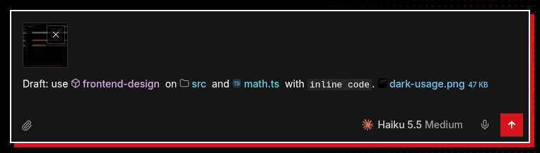 | 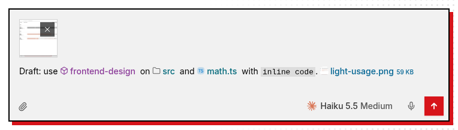 |
| 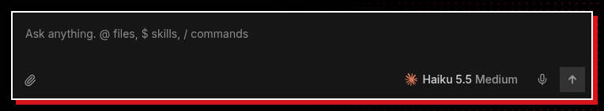 | 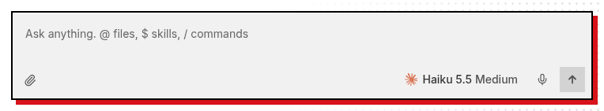 |
| 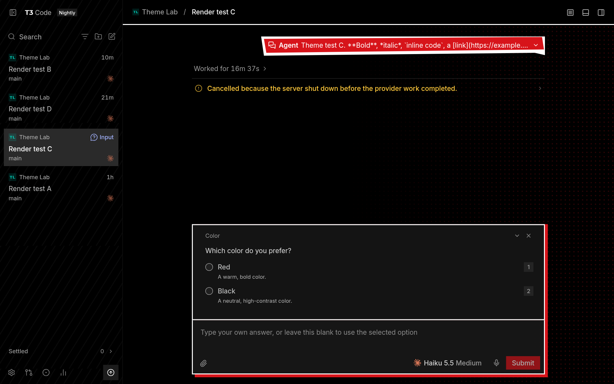 | 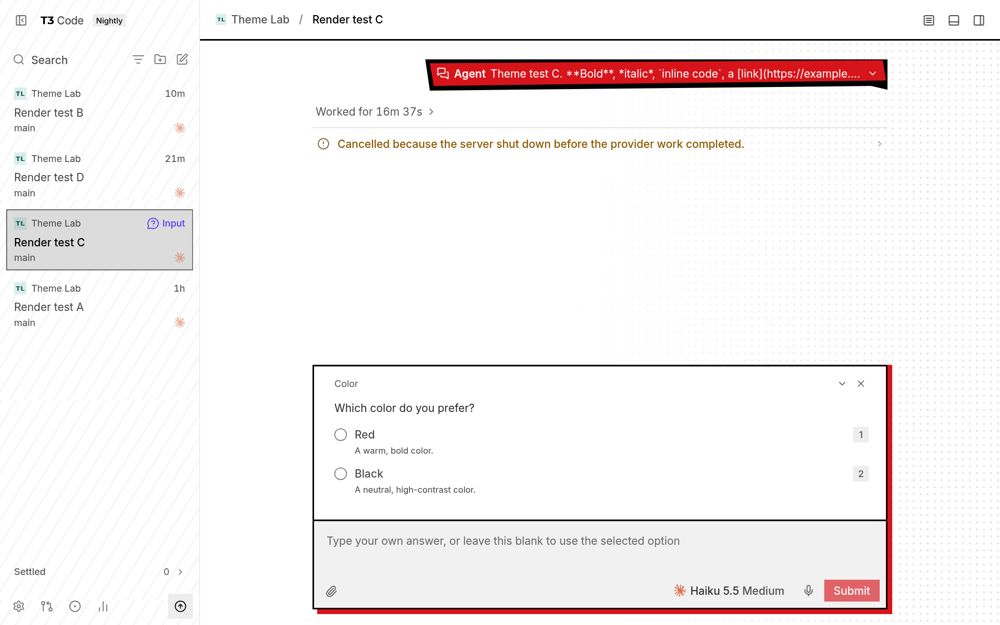 |

### Your messages

| Dark | Light |
|---|---|
| 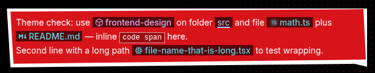 | 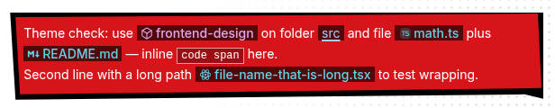 |
| 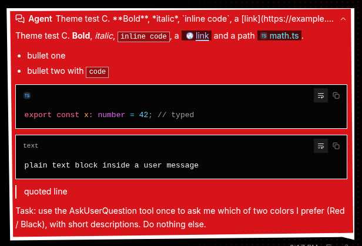 | 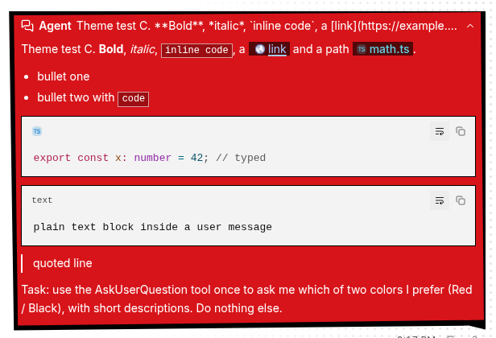 |

### A reply with every markdown element

Headings, lists, task lists, a table, a dozen code-block languages, a diff, a Mermaid diagram, `<details>`, footnotes, and Japanese and Korean text.

| Dark | Light |
|---|---|
| 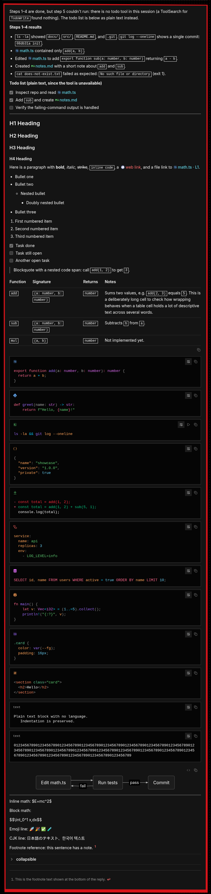 | 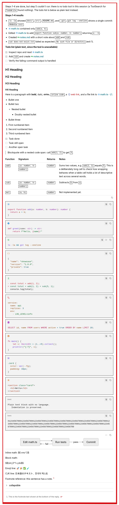 |

## Limits

T3 Code themes can't reach the terminal text, the file tree or the inside of the diff viewer with CSS. Those use the theme's color roles only.

The CSS targets the stable selectors T3 Code documents for themes. A few rules also match class names or attributes the app uses today, such as chip color variables and code-block languages. A future T3 Code release could change those.

## License

[MIT](LICENSE)
